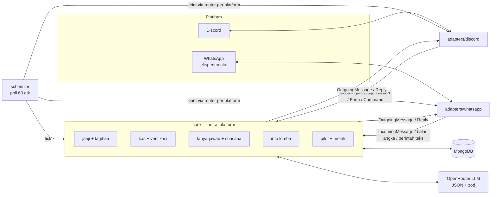

# Arsitektur

Dokumen ini untuk developer yang baru bergabung. Aturan wajibnya ada di [`CLAUDE.md`](../CLAUDE.md);
di sini penjelasan *kenapa* dan *bagaimana* alurnya.

## Gambaran besar

```
                ┌────────────────────── core (netral platform, TANPA discord.js) ──────────────────────┐
Discord ──► adapters/discord ──IncomingMessage──► onMessage ─► kas · janji · tanya-jawab · wawancara
   ▲            │  ActionEvent / FormSubmit ─────► onAction / onForm ─► handler per prefix id
   │            │  CommandInvocation ────────────► onCommand ─► COMMANDS (core/commands.ts)
   │            ▼                                   │
   └──── render OutgoingMessage / Reply ◄───────────┘
                                         scheduler (poll 60 dtk) ─► tick(): tagihan janji, pengingat kas, posting lomba
                                         db (MongoDB/Mongoose)      llm (OpenAI-compatible: OpenRouter / Hermes)
```



Core menerima tipe netral (`src/core/types.ts`) dan mengembalikan `OutgoingMessage[]` atau `Reply`.
Adapter yang mengirim. ESLint menolak `import 'discord.js'` di `src/core`, sehingga adapter WhatsApp
nanti cukup menerjemahkan tipe yang sama.

## Folder

| Folder | Isi |
|---|---|
| `src/core/types.ts` | `IncomingMessage`, `OutgoingMessage`, `Action`, `Form`, `Reply`, token mention `{{@id}}` + `sanitize()` |
| `src/core/index.ts` | `createCore()` — router pesan, tombol, form, command, dan `tick()` scheduler |
| `src/core/commands.ts` | Definisi slash command netral platform |
| `src/core/onboarding/` | Wawancara setup lewat obrolan (nama kelas, jurusan, tutur, channel, kas) |
| `src/core/promises/` | Prefilter kata kunci, ekstraksi LLM/heuristik, parser tanggal WIB, konfirmasi (tombol & ketik), `voice.ts` (kalimat per tutur & suasana) |
| `src/core/billing/` | Tahap tagihan H-2/H-1/H-0/lewat + template unggah-ungguh |
| `src/core/kas/` | Ledger append-only, verifikasi bukti transfer (hash, refId, nominal, tanggal), rekap, CSV |
| `src/core/chat/` | Deteksi suasana (`mood.ts`), konteks obrolan (`context.ts`), menjawab pertanyaan tugas/kas/lomba (`ask.ts`) |
| `src/core/summary/` | Buffer pesan (TTL 48 jam) + `/rangkum` |
| `src/core/opps/` | Info lomba, relevansi per jurusan, posting maks 2/minggu, "Bentuk tim" |
| `src/adapters/discord/` | discord.js v14: event → tipe core, render tombol/embed/modal, daftar slash command |
| `src/llm/` | `LLMProvider` (`chat`, `vision`), implementasi OpenRouter dengan key & model cadangan; prompt di `prompts/` |
| `src/scheduler/` | Loop polling; semua tahap disimpan di DB sehingga aman restart |
| `src/db/` | Skema Mongoose |
| `scripts/` | `simulate.ts` (e2e tanpa Discord), `eval-voice.ts` (uji suara bot ke LLM asli), `hermes-profile.sh` |
| `test/` | Unit test logika core (`bun test`) |

## Alur pesan masuk (`onMessage`)

Urutan di `src/core/index.ts` — begitu satu tahap menghasilkan balasan, tahap berikutnya dilewati:

1. Simpan ke buffer (rangkuman & konteks suasana, TTL 48 jam), catat anggota.
2. Wawancara setup aktif? → lanjutkan wawancara.
3. Gambar di channel kas → baca bukti transfer (LLM vision) → verifikasi → tombol bendahara.
4. Balasan "jadi dong" / "ga jadi" dari pemilik janji yang menunggu konfirmasi → konfirmasi/batal.
5. Prefilter kata kunci janji → LLM ekstraksi JSON (zod) → bot nimbrung + tombol ✅ ✏️ ❌.
6. Pertanyaan soal tugas/kas/lomba (atau bot di-tag/dibalas) → jawab dari fakta database.

## Tombol & form

`Action.id` berformat `prefix:verb:id`. Router memilih handler dari prefix:

| Prefix | Handler |
|---|---|
| `p` / `pf` | janji (tombol / form ubah) |
| `k` / `kf` | kas (approve/tolak bukti / form) |
| `o` | info lomba (Bentuk tim) |
| `ob` | wawancara setup |

Setiap handler memeriksa izin sendiri (mis. hanya pemilik janji yang bisa konfirmasi).

## Data (MongoDB)

| Koleksi | Umur | Catatan |
|---|---|---|
| `groups` | permanen | profil kelas, tingkat tutur, channel, pengaturan kas |
| `members` | permanen | anggota yang pernah terlihat (`platform` + `platformUserId`, bukan ID Discord mentah di logika) |
| `promises` | permanen | status `pending_confirm → active → done/overdue/cancelled`, tahap tagihan |
| `kasproofs` | permanen | bukti transfer + flag verifikasi + status review |
| `transactions` | permanen, **append-only** | hook Mongoose melempar error untuk update/delete; koreksi = transaksi baru |
| `kasreminders` | permanen | jejak pengingat agar tidak dobel |
| `messagebuffers` | **TTL 48 jam** | pesan mentah untuk rangkuman & konteks suasana |
| `opportunities`, `opposts` | permanen | info lomba (global atau per server) & jejak posting |
| `onboardings` | TTL 3 hari | state wawancara setup |

## LLM

- Semua ekstraksi meminta JSON dan divalidasi zod; gagal parse → abaikan / pakai heuristik, bot tidak crash.
- Tanpa API key: deteksi janji tetap jalan dengan heuristik; rangkuman & bukti transfer nonaktif.
- `LLM_TEXT_MODEL` boleh berisi beberapa model dipisah koma; model × key dicoba berurutan dengan cooldown.
- OpenRouter memakai `provider.sort=latency` (GLM 5.3 Flash ±1–2 dtk alih-alih 3–9 dtk).
- Kalimat buatan LLM selalu melewati pagar (`acceptLlmLine`, `tidyReply`): tanpa link, tanpa
  `@everyone`, panjang dibatasi, tawa dibuang kalau suasana tidak santai. Kalau ditolak → template.

## Scheduler

`startScheduler` memanggil `core.tick()` tiap 60 dtk (dipercepat oleh `DEMO_TIME_SCALE`).
Tahap tagihan diklaim atomik dengan `findOneAndUpdate` bersyarat, jadi dua instance / restart tidak
mengirim pesan dobel. Tidak ada timer di memori.

## Keamanan (ringkas)

Lihat [`SECURITY.md`](../SECURITY.md). Inti: izin bot minimal (tanpa Administrator),
`allowedMentions` hanya user eksplisit, `sanitize()` menetralkan token mention palsu dari teks
user/LLM, info lomba dicakup per server, key cadangan hanya dikirim ke host OpenRouter.
